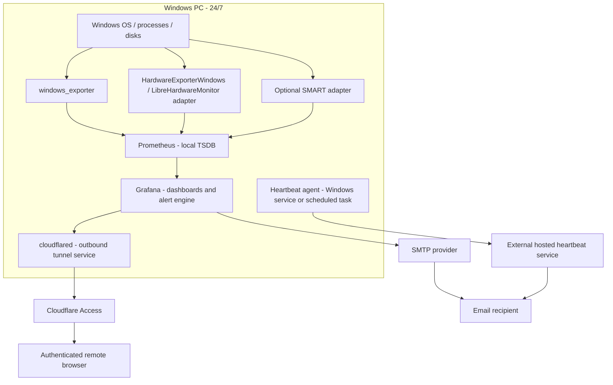

# PC Monitor — Windows-first, self-hosted observability & alerting

> **Status:** Implementation-ready requirements for Codex  
> **Version:** 1.0 — 2026-11-13  
> **Primary platform:** Windows 10/11 x64  
> **License goal:** Public GitHub repository; choose a compatible open-source license after auditing dependencies.  
> **Owner-specific deployment:** Cloudflare Tunnel + Cloudflare Access; email recipient `nared.fsk@gmail.com`.

## 0. Instructions for Codex

Implement this project as a **reproducible, maintainable, Windows-first open-source monitoring distribution**, not as a custom Grafana replacement. Reuse Prometheus, Grafana, `windows_exporter`, and supported hardware exporters; build small PowerShell scripts, configuration templates, validation and provisioning tools only where necessary. Every step must work **without Docker or WSL** on Windows 10/11. Do not assume administrator rights except where installing Windows services, reading restricted sensors/SMART, or configuring system settings requires them.

**Do not claim hardware sensors, SMART values, alert rules, Cloudflare DNS, email sending, or Windows service startup work without testing them.** Provide precise error messages, diagnostics, and graceful degradation when hardware does not expose metrics. No test or installer should silently change firewall, cloud DNS, registry, power settings, system services, or credentials. Require confirmation for actions that alter the host. Never commit secrets or machine-specific tokens.

Build the MVP first, with demonstrable end-to-end metrics and one real alert, then expand. Keep owner-specific values as examples or gitignored local overrides. A public GitHub clone must start in **localhost-only mode** with **no dependency on the owner's domain or email**.

## 1. Goals and scope

### Goals
- Central, responsive Grafana dashboards for CPU, memory, GPU, SSD, motherboard sensors, network, Windows state and per-process resource consumption.
- Detailed metrics: current values, 1h / 24h / 7d / 30d history, interactive panels, filtering, top-N and trend analysis.
- Configurable email notifications for sustained hardware, resource, process, storage, service and uptime problems, including resolved notifications.
- Detect offline PC **using an independent hosted heartbeat receiver**, since a fully powered-off PC cannot send its own notification.
- Run unattended 24/7 and recover after reboot, without requiring interactive Windows sign-in.
- Owner deploys a private Grafana dashboard via an existing Cloudflare setup; public repository users can operate on localhost only.
- Keep idle CPU/RAM overhead low; expose monitoring of the monitoring stack itself.

### Non-goals for v1
- Not an antivirus, EDR, full process recorder, or remote desktop solution.
- No remote execution, process killing, overclocking or automatic shutdown in MVP.
- No public unauthenticated dashboards, exporters or Prometheus UI.
- No requirement to support Linux/macOS, Docker/WSL, or large distributed fleets in MVP.
- No promise of detecting faults when external email/Internet/monitoring provider is unavailable.

### Reference host (context, not hardcoded limits)
- Windows desktop; Ryzen 5 5600GT; 32 GB RAM; discrete GPU (actual model may change); one or more SSDs; on 24/7.
- Collect detected hardware at installation and display model/driver/sensor coverage; do not assume an NVIDIA GPU or a particular SSD vendor.

## 2. Deployment profiles

| Setting | `local` default (public clone) | `owner` opt-in |
|---|---|---|
| UI URL | `http://localhost:3000` | `https://<OWNER_FQDN>` |
| Grafana/Prometheus | Native Windows services | Same |
| Access from internet | Disabled | Cloudflare Tunnel to Grafana only |
| Login | Grafana local authentication | Cloudflare Access **plus** Grafana auth |
| Notifications | Optional configurable SMTP | SMTP with `ALERT_EMAIL_TO=nared.fsk@gmail.com` |
| Offline checker | Optional user-provided hosted heartbeat | Enabled, external Healthchecks.io or equivalent |
| Secrets | Local protected environment / service secrets | Same; Cloudflare credentials separate |

**Hostname clarification:** The requested string is `pc-monitor.nared-fu`, but this does not specify a known public DNS zone/TLD. Treat it as an **intended prefix / placeholder**, not a verified usable public domain. Do not automatically append `.com`, `.net`, etc. Define `PUBLIC_HOSTNAME` as the full, externally routable FQDN and validate it. Owner must supply/confirm the actual zone. An existing Cloudflare installation does not prove the DNS zone or tunnel is configured.

For owner mode, map `https://<PUBLIC_HOSTNAME>` to Grafana at `http://127.0.0.1:3000`, using a **Cloudflare Tunnel published application**, with an **Access self-hosted application** using owner-authorized identity. No router port-forwarding is needed. Never expose ports 9090 (Prometheus), 9182 (windows_exporter), hardware exporter, Windows admin interfaces, or heartbeat credentials.

## 3. Proposed architecture



Local browser -> `http://localhost:3000`; remote owner browser -> Cloudflare Access -> Grafana. Cloudflare's Access policy MUST be set up before the public route is treated as ready. Avoid a public bypass route or direct-origin exposure.

### Chosen components
- `windows_exporter`: Windows CPU, memory, logical/physical disk, networking, OS/system, services, per-process, and (if supported) GPU counters.
- `HardwareExporterWindows` backed by LibreHardwareMonitor: CPU/GPU temperatures, fans, clocks, power and available disk sensor data. Audit maintenance, license and metric names during implementation. Hardware support is best-effort; expose sensor coverage.
- `Prometheus`: local time-series collection and retention.
- `Grafana OSS`: imported/provisioned dashboards, unified alerting, contact points, notification policies.
- Optional adapter for SMART/NVMe critical warning, media/data integrity errors, percentage used, and available spare. Select safe tooling (read-only SMART / manufacturer-neutral where possible), verify unit/model mapping and privilege requirements.
- `cloudflared` (owner only): publish Grafana securely through existing Cloudflare account.
- Healthchecks.io or equivalent external heartbeat receiver: offline alerting independent of PC power state. Hosted provider should deliver the offline email; local SMTP alone cannot.

Verify versions and pin tested releases / artifact hashes, but avoid claiming a specific latest version without rechecking official upstream. Use official distribution channels where possible.

## 4. Metrics requirements

### 4.1 CPU
- Total utilization normalized to 0–100%; usage per logical core; load pattern/interrupts where exposed.
- CPU clocks; package/core temperature when supported; power/voltage when available.
- Time window trends; min/avg/max; threshold and panel annotations.
- CPU temperature **sensor definition matters** (package vs core vs hotspot); show sensor label and unit.

### 4.2 Memory
- Total, available, used physical RAM in bytes/GB/%.
- Committed bytes/commit limit; paging/pagefile activity; memory pressure.
- Per-process working set, private working set/private bytes, and their distinction in the UI.
- Process memory growth slope over 1h/6h/24h with sustained leak *heuristics*, not a definitive diagnosis.

### 4.3 GPU
- GPU utilization, memory usage/capacity (if exposed), core/hotspot temperature, power, fan RPM, clock.
- Support AMD/NVIDIA/Intel **on a best-effort basis** through Windows counters or sensors, without vendor lock-in.
- Missing metrics must show `Not available / unsupported`; do not fake zero values.
- Optionally expose GPU process utilization only if collector and hardware supply reliable values.

### 4.4 SSD / disk
- Per-volume capacity/free/used (%); read/write throughput, IOPS and latency by physical disk and/or volume where mapping permits.
- SSD/NVMe temperature, wear/remaining life, SMART critical warning, available spare, media/data integrity errors, unsafe shutdown count, total bytes written (if supported).
- Distinguish Windows volume labels (C:) from physical SSD devices and verify accurate mapping.
- For missing SMART access, surface explicit `unsupported`, `permission denied`, or `not collected`, never healthy-by-default.

### 4.5 Processes
- Top 10/20/50 by CPU%, memory, I/O where available; search/filter by name and PID; CPU/RAM history.
- Separate aggregate-by-name and per-instance/PID views; guard against PID reuse and churn.
- Define CPU% consistently: `100% = total host CPU capacity`, not percentage of one core, and annotate what is measured. Multi-process applications (browsers) may spawn many processes.
- Alert on sustained per-process CPU and optionally per-process RAM growth/absolute limit; allow per-user exclusions (e.g. known long-running workloads).
- Limit high-cardinality labels: exclude command lines, paths, usernames and raw arguments by default; prohibit sensitive command-line capture in public UI. Support top-N / inclusion filters. Track Prometheus series count and storage impact.
- Short-lived processes may be missed between scrapes.

### 4.6 Windows/network/monitoring
- Boot time/uptime, last successful scrape, restart history where reliably observable, unexpected reboot/shutdown Event Log indicators via optional safe adapter.
- Network upload/download per adapter; network faults if counters available.
- Windows service states; health of `windows_exporter`, Prometheus, Grafana, hardware exporter, cloudflared and heartbeat agent.
- Prometheus targets UP, scrape duration, data age, TSDB disk usage, number of series; Grafana alert evaluation state.
- Avoid logging secrets, full process command lines or personal information.

### Data rules
- Use Prometheus canonical metric units (seconds, bytes, Celsius for displayed temperatures with explicit conversion).
- Do not hardcode exporter-specific metric names blindly. Build queries against live `/metrics` output and document supported versions and metric-name aliases.
- Process CPU formulas and denominator must be unit-tested on Windows; Grafana calculated values should match Task Manager within an explained tolerance.
- Label missing data as unavailable. `NoData` and `Error` must not silently be treated as OK for critical collectors.

## 5. Dashboards and UX

Responsive, clean, minimal UI, readable dark/light themes, no custom frontend required. Grafana provisioning files should live in Git. Panels should have clearly labeled units, time filters and informative missing-data states. Four primary dashboards:

1. **Overview:** online state, uptime, CPU/RAM/GPU%, top temperatures, SSD free/health, inbound/outbound network, current alerts, top process table.
2. **CPU & Thermal:** total/per-core CPU, clocks, CPU/GPU/hardware temperature and fan RPM (optional), power, correlations over time.
3. **Storage & Network:** per-disk read/write MB/s, IOPS, latency, free space, physical-to-volume mapping, SMART warnings/life/wear when present; network by adapter.
4. **Process Explorer:** top-N processes by CPU/memory, per-PID drilldown, aggregate app memory, long-run trends, suspicious sustained usage and process name filters.

Additional optional dashboard: **Monitoring Stack Health** (targets/scrapes/cardinality/disk footprint/heartbeat age). Support 1h, 6h, 24h, 7d and 30d time ranges; default recent 6h; 15–30s live refresh. Explain that continuous high refresh with high-cardinality process charts may create overhead.

## 6. Alerts: baseline policy

Thresholds below are **defaults for evaluation**, NOT manufacturer hardware safety limits. Allow per-sensor and per-PC overrides; require owner review of actual hardware specifications. Two severity levels, severity labels `warning` and `critical`. Use pending-period / `for` durations and suitable recovery hysteresis to avoid notification storms.

| Alert | Warning | Critical | Required input |
|---|---|---|---|
| Offline | — | External heartbeat missing for around 5 minutes | Independent hosted checker |
| CPU package temperature | >80°C for 5m | >90°C for 2m | Valid CPU temperature sensor |
| GPU temperature | >80°C for 5m | >88°C for 2m | Valid GPU temperature sensor |
| RAM utilization | >85% for 10m | >95% for 5m | Windows memory metrics |
| SSD temperature | >60°C for 5m | >70°C for 2m | Valid disk temperature sensor |
| Per-process CPU | >70% host capacity for 10m | >90% host capacity for 5m | Process CPU rate with host-capacity normalization |
| Disk free space | <15% for 10m | <5% for 5m | Per-volume disk free metrics |
| SMART/NVMe critical warning | — | Immediate upon confirmed critical SMART state | Real SMART data |
| SMART media/data errors | Increase detected (configurable) | Rapid error increase or critical state (configurable) | Counter and device ID |
| SMART remaining life | <20% (if available) | <10% (if available) | Valid vendor-defined life indicator |
| Memory leak heuristic | Working set/private bytes growing substantially over 6h (opt-in) | Sustained growth + high absolute RAM consumption (opt-in) | Long history / process identity |
| Monitoring target DOWN | >2m | Critical target DOWN >5m (optional) | Prometheus `up` |
| Collector no-data/error | Warning on missing telemetry | Critical if important sensors unexpectedly vanish | Alert eval NoData/Error policy |
| Unplanned restart | — | Detect post-recovery using boot timestamp/event data | Supported reboot metric/log |

Note: If individual process CPU is measured as percent of *host total* capacity, a single-thread CPU-bound task on a many-thread Ryzen may be far below 70%. Provide alternative rule **per-core equivalent or configurable per-process baseline** to identify a stuck task accurately; avoid relying on the illustrative 70/90% default alone.

### Notification behaviour
- Email contact point using user-configured SMTP (SSL/STARTTLS; credentials never in Git).
- Owner recipient: `nared.fsk@gmail.com` in owner-local config only, with generic `ALERT_EMAIL_TO` in Git examples.
- Message: `[WARNING]` / `[CRITICAL]` / `[RESOLVED]`, hostname/device, affected metric, observed value, threshold, duration, timestamp with timezone (`Asia/Bangkok` for owner), Grafana dashboard link (using configured public/local URL), short action recommendation.
- Group by host/severity; deduplicate; initial repeat intervals e.g. warning every 4h and critical every 1h, configurable. Recovery notification on resolve. Avoid escalating on a single short spike.
- Keep email templates generic and privacy-safe (no command-line arguments, keys, private IPs unless opt-in).
- Test with a **non-destructive synthetic metric / dedicated test alert**, not by deliberately overheating hardware.
- If SMTP unavailable, show explicit alert delivery failure locally; do not claim offline email redundancy from the same PC.

### External offline checker
- Heartbeat every 60 seconds from a Windows service or scheduled task. Hosted check uses an interval/grace configuration that yields an email roughly after 5 minutes without pings (account for provider evaluation delay, not strict real-time SLA).
- Ping secret stored locally, never embedded in a Grafana dashboard or public repo; use HTTPS and modest retries with timeout/jitter.
- Must continue running across locked screen/no interactive user and resume after reboot.
- External service sends `DOWN` and `RECOVERED` emails directly and independently. Track what offline means: PC shutdown/crash, sleep, Windows agent fault, network outage or hosted provider outage are indistinguishable solely by missing heartbeat.
- For planned maintenance/shutdown, provide documented pause/snooze procedure. Do not auto-mark heartbeat success from another independent host, which would mask true PC downtime.
- Optionally add an **end-to-end health heartbeat** dependent on successful Prometheus scrape / alerts evaluation, separate from bare PC-alive heartbeat.

## 7. Configuration and secrets

Implement typed, documented configuration with validated defaults. Suggested non-secret `.env.example` keys (scripts can read a supported local config instead of directly passing environment variables to Windows services):

```dotenv
DEPLOYMENT_PROFILE=local
PUBLIC_HOSTNAME=
GRAFANA_URL=http://localhost:3000
GRAFANA_BIND_ADDRESS=127.0.0.1
GRAFANA_PORT=3000
PROMETHEUS_BIND_ADDRESS=127.0.0.1
PROMETHEUS_PORT=9090
WINDOWS_EXPORTER_BIND_ADDRESS=127.0.0.1
WINDOWS_EXPORTER_PORT=9182
HARDWARE_EXPORTER_PORT=9183
SCRAPE_INTERVAL=15s
RETENTION_TIME=30d
RETENTION_SIZE=10GB
GRAFANA_TIMEZONE=browser
ALERT_EMAIL_TO=
SMTP_HOST=
SMTP_PORT=587
SMTP_USER=
SMTP_FROM=
# Secrets, including SMTP_PASSWORD, are intentionally omitted from this template.
HEARTBEAT_ENABLED=false
HEARTBEAT_INTERVAL_SECONDS=60
HEARTBEAT_URL=
CLOUDFLARE_ENABLED=false
```

Owner-only local override, **never committed**:

```dotenv
DEPLOYMENT_PROFILE=owner
PUBLIC_HOSTNAME=<CONFIRMED_FULL_FQDN>
GRAFANA_URL=https://<CONFIRMED_FULL_FQDN>
ALERT_EMAIL_TO=nared.fsk@gmail.com
GRAFANA_TIMEZONE=Asia/Bangkok
HEARTBEAT_ENABLED=true
CLOUDFLARE_ENABLED=true
```

Sensitive settings: SMTP password/API key, Grafana initial admin password, Cloudflare tunnel token/credentials, Healthchecks ping URL, optional Access service tokens. Use OS ACLs / Windows Credential Manager or another documented secure service-usable secret store; if environment/config files are used, restrict filesystem ACL to appropriate service identities and administrators. Do not print secrets to logs or process command lines, export secrets as metrics, or include them in sample outputs. Prevent accidental inclusion via `.gitignore`, precommit checks and GitHub secret scanning guidance.

**Email address is a recipient setting, not a credential.** Never assume email recipient and SMTP authentication account must match. For Gmail SMTP, document Google App Password and account prerequisites as an option; do not commit it or require Gmail specifically.

## 8. Networking and security

### Local profile
- Grafana UI `127.0.0.1:3000`, Prometheus `127.0.0.1:9090`, exporter `127.0.0.1:9182` and hardware exporter loopback only.
- If an exporter cannot bind loopback in the chosen build, secure access via Windows Firewall and explicitly document the residual risk; reject deployment if insecure without user override.
- Grafana anonymous login disabled; create unique strong admin credentials. Hide/protect admin functions from non-admin viewers. Disable unused signup/public sharing.

### Owner Cloudflare profile
1. Check actual Cloudflare zone / FQDN and existing tunnel. **Never assume `pc-monitor.nared-fu` is valid public DNS.**
2. Create or reuse a Cloudflare Tunnel; configure one published HTTPS hostname to `http://127.0.0.1:3000`; no inbound port forwarding.
3. Protect the hostname with a Cloudflare Access self-hosted application restricting access to the owner-approved identity. Explicitly verify unauthenticated access is denied.
4. Keep Grafana auth enabled as defense in depth. Set Grafana `root_url` to the public HTTPS FQDN in owner mode; preserve localhost access and callback/link correctness.
5. `cloudflared` runs as Windows service with automatic restart. Cloudflare tunnel credentials stored outside repository.
6. Do **not** expose Prometheus/exporter endpoints through tunnel and do not put Access tokens in browser-visible dashboard variables.
7. Document Cloudflare Access availability and whether plan/identity configuration imposes any restrictions. Do not invent Access Team Domain/AUD values: obtain them from actual owner dashboard **only if needed** for a specific authentication integration; basic Access-fronted Grafana need not force application-side JWT validation in MVP.

For security-critical Cloudflare deployment, prefer a manually reviewed step-by-step checklist over unattended remote modification. Disallow localhost-bypass claims where Grafana still has local direct access; note that anyone with local PC access may reach the local login page.

## 9. Windows service behavior and installation

- Native Windows binary installations or bundled, checksum-verified upstream releases (license-compliant), plus documented installation scripts.
- PowerShell 5.1+ compatibility preferred (state any PowerShell 7+ requirement explicitly).
- `install.ps1`, `uninstall.ps1`, `start.ps1`, `stop.ps1`, `status.ps1`, `doctor.ps1`, `test-alert.ps1`, `test-heartbeat.ps1`, `backup.ps1` (names can be adapted but cover functions).
- Idempotent installers: reruns should update safe config while preserving user secrets and TSDB data; no silent reinstall/reset.
- Services auto-start after boot, restart-on-failure policy, logs/events and dependency order; cover scenario where network isn't ready at startup.
- Use dedicated least-privilege accounts where feasible; document exceptions for sensor access and service installation.
- Include uninstall paths separately for binaries/services, local config and historic metrics; require explicit user approval before deleting data.
- Provide optional Windows Scheduled Task heartbeat implementation as fallback (running whether user is logged on or not), but document credential handling and startup reliability.
- Never automatically change Windows Update, UAC, Secure Boot, sleep/hibernate, fan control, BIOS or overclock settings.
- Document optional Windows power settings checks for a 24/7 host; do not change them without explicit opt-in.

## 10. Operational settings and performance budget

- Scrape every **15s**, sensor polling 10–15s when supported; heartbeat **60s**.
- Retain approximately **30 days**, with time retention and a configurable **size guard** (e.g. 10GB initial cap), no fixed promise of exact storage footprint.
- Dashboard refresh 15–30s; avoid expensive high-cardinality panels being refreshed too aggressively.
- Estimate and measure own CPU, resident RAM, Prometheus active series, scrape duration, WAL/TSDB disk write rate, monthly storage. Provide a `doctor` / performance page with measurements after install.
- Cardinality management: process inclusion/exclusion, label whitelist, avoid raw command-line labels, avoid uncontrolled PID historical growth; metric relabel drop rules only after checking target queries.
- Plan for disk growth and retention: alert if monitoring-data drive low, and ensure WAL/TSDB failure is surfaced.
- Test unattended 24/7 stability, startup after forced reboot, recovery from crash, Internet offline/online, and service restarts.

## 11. Repository structure (recommended)

```text
pc-monitor/
├── README.md
├── LICENSE
├── .gitignore
├── .env.example
├── config/
│   ├── local.example.env
│   ├── owner.example.env
│   ├── prometheus.yml.tpl
│   ├── exporters/
│   └── grafana/
│       ├── provisioning/datasources/
│       ├── provisioning/dashboards/
│       ├── provisioning/alerting/
│       └── dashboards/
│           ├── overview.json
│           ├── cpu-thermal.json
│           ├── storage-network.json
│           ├── processes.json
│           └── monitoring-health.json
├── scripts/
│   ├── install.ps1
│   ├── uninstall.ps1
│   ├── start.ps1
│   ├── stop.ps1
│   ├── status.ps1
│   ├── doctor.ps1
│   ├── test-alert.ps1
│   ├── test-heartbeat.ps1
│   ├── backup.ps1
│   └── validate-config.ps1
├── src/
│   ├── heartbeat/           # Only if Windows task alone is insufficient
│   └── smart-adapter/       # Optional, only when a maintained exporter is inadequate
├── tests/
│   ├── config/
│   ├── powershell/
│   ├── prometheus/
│   ├── dashboards/
│   └── integration/
└── docs/
    ├── INSTALL_WINDOWS.md
    ├── CLOUDFLARE_OWNER.md
    ├── SMTP_ALERTS.md
    ├── OFFLINE_HEARTBEAT.md
    ├── METRICS_REFERENCE.md
    ├── HARDWARE_COMPATIBILITY.md
    ├── SECURITY.md
    ├── TROUBLESHOOTING.md
    └── CONTRIBUTING.md
```

Do not check in generated `data/`, Grafana SQLite databases, password files, tunnel JSON/token, WAL, binary downloads, per-PC system inventory or local logs.

## 12. Implementation sequence and deliverables

### Phase 1 — Core local monitoring (must work first)
1. Detect OS/architecture, privileges, service state and port conflicts; generate local config.
2. Install/start windows_exporter with `cpu,memory,logical_disk,physical_disk,net,os,system,process,service` (verify actual supported collectors against pinned release).
3. Install/start Prometheus on loopback; scrape Windows exporter every 15s; retention 30d with optional size cap.
4. Install/start Grafana on loopback; provision Prometheus datasource and Overview/Process dashboard.
5. Validate a real Windows process appears with CPU/RAM values and no data leakage.
6. Provide install/doctor/readme and tests. **Definition of done:** localhost dashboard works, all three services survive reboot.

### Phase 2 — Sensors, disks and full dashboards
1. Evaluate maintenance/licensing/Windows support of HardwareExporterWindows and LibreHardwareMonitor; pin tested release, handle privileges.
2. Add real CPU/GPU temperatures and sensors; use `Not available` if unsupported.
3. Add optional SMART data adapter with read-only access and cross-check with an independent SMART diagnostic tool where possible.
4. Complete CPU/Thermal, Storage/Network, Process Explorer and Stack Health dashboards.
5. Compare CPU/process memory and disk values with Windows Task Manager, Resource Monitor or PowerShell counters.

### Phase 3 — Email alerts
1. Secure SMTP config; Grafana email contact point, notification policy and alert provisioning.
2. Implement threshold rules with per-device overrides, pending periods, resolved notifications, labels and recommended response.
3. Add synthetic test alert and verify receipt + delivery failure diagnosis.
4. Establish no-data/error behavior and service-down alerts.

### Phase 4 — Reliable offline detection
1. Configure hosted Healthchecks-style endpoint externally; ping every 60s from Windows.
2. Set appropriate period/grace for about 5-minute missing-heartbeat notification, respecting provider latency.
3. Test heartbeat suspension, loss of connectivity, offline email and recovery email; document planned maintenance/snooze.
4. **Definition of done:** external email arrives even while the PC and local Grafana/Prometheus are not running (assuming Internet/email service available to the external provider).

### Phase 5 — Optional owner Cloudflare deployment
1. Owner confirms full public FQDN and Cloudflare zone/tunnel ownership.
2. Create/reuse `cloudflared` service, map hostname -> `127.0.0.1:3000` and enable Access email/identity restriction.
3. Test both allowed and denied identities, HTTPS, auth redirects, no public exporter/Prometheus access.
4. Set external Grafana root URL, links, recovery buttons, and install guide.
5. Preserve default localhost mode and avoid including owner's private tokens in open-source templates.

### Phase 6 — GitHub publication
1. Finalize license/third-party notices/versions and verify redistribution terms.
2. Supply README with architecture, screenshots (synthetic/anonymized), prerequisites, one-command-ish installation, uninstallation, FAQ.
3. Supply CI for lint/config validation/promtool rules/dashboard JSON/PowerShell script testing; Windows CI smoke tests where practical.
4. Security check for hardcoded tokens, absolute machine paths, owner's email where it doesn't belong, and public endpoints.
5. Create release checklist; support documented manual upgrades/rollback.

## 13. Functional acceptance tests

| ID | Test | Pass criterion |
|---|---|---|
| T01 | Fresh Windows 10/11 x64 clone, profile `local` | Grafana opens at localhost; no Cloudflare or owner credentials needed |
| T02 | Service reboot | Exporter, Prometheus, Grafana start without user login |
| T03 | CPU/RAM/SSD/network metrics | Genuine values, expected units, historical graph |
| T04 | Processes by CPU/RAM | Correct name and PID; aggregation; sensible normalized CPU% |
| T05 | GPU and temperature absent | Clear unsupported / no-data, not misleading zero/healthy state |
| T06 | SMART capable drive | Values present and mapped to right physical drive; documented units |
| T07 | High CPU synthetic alert | Test alert evaluates and email arrives; no unsafe CPU stress required |
| T08 | Alert resolves | Resolved email and proper deduplication/repeat controls |
| T09 | Windows exporter stopped | Target-down or data-missing alert reflects outage |
| T10 | PC heartbeat stopped | Hosted service emails offline even while local services stopped |
| T11 | Heartbeat resumed | Hosted recovery email and last-success status |
| T12 | Owner Cloudflare hostname | Valid HTTPS URL, Access authentication required |
| T13 | Unauthenticated remote access | Denied; no bypass to Prometheus/exporters |
| T14 | Secret scan/public repo | No real passwords, tokens, heartbeat URL or credentials committed |
| T15 | Reinstall/upgrade | Config, secrets and historic metrics preserved; rollback documented |
| T16 | Storage limit | Retention/size guard works; monitoring disk pressure reported |
| T17 | Alert while SMTP unreachable | Delivery failure visible and documented; no false claim of delivery |
| T18 | Owner-local customization | Recipient `nared.fsk@gmail.com`, Asia/Bangkok and owner domain appear only in local effective config, not required for other installs |
| T19 | Hardcoded metric check | Dashboard queries verified against actual exporter metrics in pinned releases |
| T20 | Security / open ports | Only intended UI reachable; monitoring endpoints loopback / firewall restricted |

## 14. Documentation requirements

- **README**: what it does, screenshots, architecture, supported Windows versions, minimum setup, capability matrix and limits.
- **INSTALL_WINDOWS**: prerequisites, admin prompts, dependency versions, files and service locations, troubleshooting.
- **METRICS_REFERENCE**: metric names and PromQL expressions verified against pinned exporters, units, collection limitations and vendor differences. Do not blindly reuse old metric names.
- **HARDWARE_COMPATIBILITY**: supported and untested CPU/GPU/SSD sensors; permissions and typical reasons for missing metrics.
- **SMTP_ALERTS**: Grafana email contact point, SMTP secure setup, template and dry-run.
- **OFFLINE_HEARTBEAT**: hosted receiver, exact ping frequency, grace settings, status semantics, pause/resume and recovery test.
- **CLOUDFLARE_OWNER**: optional public hostname; setup for already-existing Cloudflare account; Access policy and tunnel Windows service, without secrets.
- **SECURITY**: threat model of remotely exposed admin dashboard, local service ACLs, secret storage and least privilege.
- **TROUBLESHOOTING**: exporter's `/metrics`, Prometheus targets, Grafana datasource/alert provisioning, Windows Event Viewer and cloudflared diagnostics.
- **CONTRIBUTING**: coding standards, tests, supported metrics, issue templates and release process.

## 15. Key implementation risks

1. **Cloudflare hostname**: provided `pc-monitor.nared-fu` lacks a confirmed TLD/zone. Validate before publishing. Configure with a full FQDN, never guess.
2. **Per-process CPU**: many exporters report CPU seconds across cores; divide by total logical CPU capacity to display 0–100% host total. Compare with actual Windows Task Manager behavior; expose per-core equivalent as an alternative.
3. **SMART/temperatures**: sensor visibility differs by motherboard, device, rights, GPU driver and exporter version; unsupported means unknown, not healthy.
4. **Metrics cardinality**: collecting every PID at 15-second intervals may increase TSDB size and CPU usage. Give sane filters/retention.
5. **Local email on power loss**: cannot send anything after PC stops. External independent receiver is mandatory for offline emails.
6. **Email is not guaranteed delivery**: SMTP, spam filtering and external provider incidents are outside this app's full control. Surface provider health where feasible.
7. **Open-source privacy**: owner address is a configurable deployment choice, not a mandatory value or credential. No owner's passwords/tokens or real telemetry in Git.
8. **Secure tunneling**: Cloudflare Tunnel itself is not an authorization policy. Cloudflare Access restrictions are mandatory for owner-facing remote exposure.

## 16. Suggested source documentation (review again during implementation)

- Cloudflare Tunnel: https://developers.cloudflare.com/tunnel/get-started/
- Cloudflare Access self-hosted applications: https://developers.cloudflare.com/cloudflare-one/access-controls/applications/http-apps/self-hosted-public-app/
- Cloudflare Windows service: https://developers.cloudflare.com/tunnel/features/locally-managed-tunnels/as-a-service/windows/
- windows_exporter: https://github.com/prometheus-community/windows_exporter
- windows_exporter process collector: https://github.com/prometheus-community/windows_exporter/blob/main/docs/collector.process.md
- HardwareExporterWindows: https://github.com/naughtyGitCat/HardwareExporterWindows
- Grafana Contact Points: https://grafana.com/docs/grafana/latest/alerting/configure-notifications/manage-contact-points/
- Healthchecks.io: https://healthchecks.io/ and https://github.com/healthchecks/healthchecks
- Prometheus: https://prometheus.io/docs/

## 17. Definition of complete

The project is complete when a user can clone a public repo, install on a supported Windows PC and see a useful localhost dashboard with **real** system and process data; optionally enable sensors and email alerts; independently detect PC offline through hosted heartbeat; and optionally expose **only authenticated Grafana** through a personal Cloudflare-protected public hostname. All optional services and secrets must be configurable per installation. No unsupported sensor should silently appear healthy. Include tests and truthful limitations.
