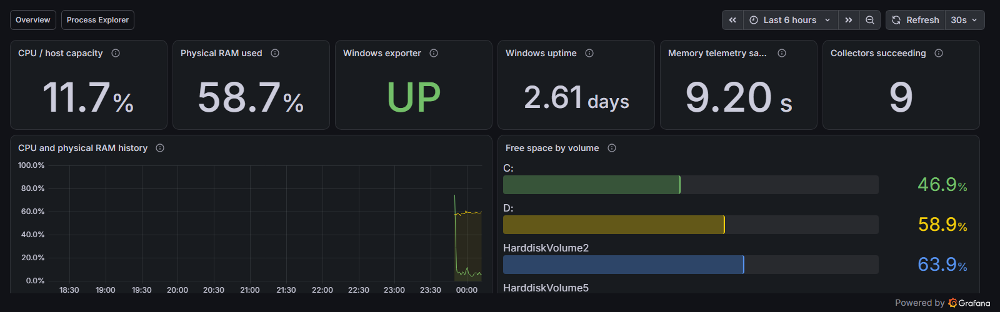
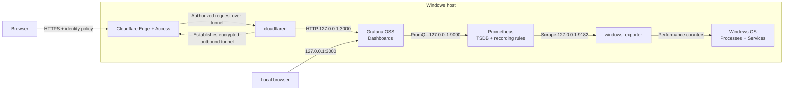

# Windows PC Monitoring

ระบบมอนิเตอร์ Windows แบบ self-hosted ที่ติดตั้ง `windows_exporter`, Prometheus และ Grafana เป็น Windows services พร้อม dashboard, lifecycle scripts และ diagnostics ที่ออกแบบให้ใช้งานบนเครื่องเดียวได้อย่างปลอดภัย

โปรเจกต์นี้ไม่มี custom web server หรือฐานข้อมูลของตัวเอง: metrics มาจาก Windows โดยตรง, Prometheus เป็นผู้เก็บ time series และ Grafana เป็นหน้าจอแสดงผล ส่วน Cloudflare Tunnel/Access เป็นทางเลือกสำหรับเปิดดูจากภายนอกโดยไม่เปิดพอร์ต inbound เข้าสู่เครื่อง



> ภาพ Dashboard ใช้ข้อมูล metrics จริงจาก reference deployment ค่าที่เห็นจึงเปลี่ยนไปตามแต่ละเครื่อง ภาพไม่แสดง credential, Access token, อีเมล, ชื่อเครื่อง, PID หรือชื่อ process

## จุดเด่น

- ดู CPU, physical memory, uptime, disk/volume, network และสถานะ exporter
- วิเคราะห์ process ด้วย CPU ที่ normalize เทียบกับกำลังรวมของเครื่อง, working set และ private allocation
- มี Grafana dashboard พร้อมใช้ 2 ชุด: **PC Monitor / Overview** และ **PC Monitor / Process Explorer**
- ทุก application endpoint bind เฉพาะ `127.0.0.1` โดยค่าเริ่มต้น
- ตรวจสอบ official HTTPS URL และ SHA-256 ของ upstream artifacts ก่อนติดตั้ง
- ติดตั้งและควบคุมบริการผ่าน PowerShell โดยมี plan-only mode, `WhatIf` และ ownership verification
- แยก binaries, configuration, data, logs และ secrets พร้อม ACL สำหรับ service accounts
- มี `status`, `doctor`, backup/restore และ automated regression checks
- รองรับ Cloudflare Tunnel + Access เป็นชั้นป้องกันภายนอก โดยแยกออกจากความรับผิดชอบของ core installer

## สถาปัตยกรรม



Cloudflare เป็น optional path เท่านั้น การใช้งานบนเครื่องสามารถเปิด Grafana ผ่าน `http://127.0.0.1:3000` ได้โดยตรง Prometheus และ exporter ไม่ถูก publish ออกสู่ภายนอก

### Services และ endpoints

| Service | หน้าที่ | Account / ownership | Endpoint เริ่มต้น |
| --- | --- | --- | --- |
| `PCMonitor-Exporter` | อ่าน Windows metrics | `LocalSystem` | `127.0.0.1:9182` |
| `PCMonitor-Prometheus` | Scrape, recording rules และ TSDB | `NT AUTHORITY\LocalService` | `127.0.0.1:9090` |
| `PCMonitor-Grafana` | Dashboard และ visualization | `NT AUTHORITY\LocalService` | `127.0.0.1:3000` |
| `cloudflared` | Optional external access | นอกขอบเขต core installer | ส่งต่อเฉพาะ Grafana |

### Upstream components ที่ล็อกเวอร์ชัน

| Component | Version |
| --- | ---: |
| Prometheus | `3.16.0` |
| windows_exporter | `0.32.1` |
| Grafana OSS | `13.3.1` |
| WinSW .NET461 | `2.12.0` |

รายละเอียด URL, SHA-256, archive type และ license metadata อยู่ใน [dependency lock](config/dependencies.lock.json)

## Dashboard

### PC Monitor / Overview

Dashboard 12 panels สำหรับภาพรวมของเครื่อง ได้แก่ CPU, RAM, exporter health, uptime, telemetry age, collector success, disk free space, network throughput และ process ranking

### PC Monitor / Process Explorer

Dashboard 10 panels สำหรับเจาะระดับ process โดยแยก CPU ratio, CPU core equivalents, resident/private working set, committed private allocation และตัวตนของ process จาก PID ร่วมกับ start time

คำจำกัดความของ metrics และข้อควรระวังในการตีความอยู่ใน [Metrics Reference](docs/METRICS_REFERENCE.md)

## เริ่มใช้งาน

### ความต้องการเบื้องต้น

- Windows 10/11 x64
- Windows PowerShell 5.1
- สิทธิ์ Administrator สำหรับการติดตั้งและจัดการ services/ACL
- Internet access สำหรับดาวน์โหลด upstream artifacts ครั้งแรก

นโยบาย Windows App Control หรือ Smart App Control อาจบล็อก upstream executable ที่ไม่ได้เซ็น โปรเจกต์นี้จะ fail closed และไม่ปิดหรือ bypass policy ของเครื่องโดยอัตโนมัติ

### 1. ตรวจ source และ install plan

รันจากโฟลเดอร์ repository ใน PowerShell ปกติ:

```powershell
powershell.exe -NoProfile -ExecutionPolicy Bypass -File .\tests\Invoke-Checks.ps1 -Stage Core
powershell.exe -NoProfile -ExecutionPolicy Bypass -File .\scripts\install.ps1 -WhatIf -AsJson
```

คำสั่งที่สองจะแสดงแผนโดยไม่ดาวน์โหลดไฟล์, สร้าง service, เปลี่ยน ACL หรืออ่าน `.env`

### 2. ติดตั้ง

เปิด PowerShell แบบ **Run as administrator** แล้วรัน:

```powershell
Set-ExecutionPolicy -Scope Process -ExecutionPolicy Bypass
$grafanaPassword = Read-Host 'New Grafana admin password' -AsSecureString
.\scripts\install.ps1 -Apply -GrafanaAdminPassword $grafanaPassword
```

อย่าใส่ Grafana password, Cloudflare token หรือ secret อื่นใน `.env`, configuration file, command history หรือ service arguments

### 3. ตรวจสุขภาพ

```powershell
powershell.exe -NoProfile -ExecutionPolicy Bypass -File .\scripts\status.ps1 -AsJson
powershell.exe -NoProfile -ExecutionPolicy Bypass -File .\scripts\doctor.ps1 -AsJson
```

จากนั้นเปิด `http://127.0.0.1:3000` และล็อกอิน Grafana ด้วย username `admin`

## Configuration

คัดลอก [config/local.example.psd1](config/local.example.psd1) เมื่อต้องการ override ค่าเริ่มต้น โดยห้ามใส่ secret ในไฟล์นี้

ค่า default สำคัญ:

| Setting | Default |
| --- | ---: |
| Scrape interval | `15s` |
| Retention time | `30d` |
| Retention size | `10GB` |
| Grafana / Prometheus / Exporter | `3000` / `9090` / `9182` |

Retention time และ retention size เป็นคนละเพดาน Prometheus สามารถลบข้อมูลก่อนครบ 30 วันได้หากถึงขนาดที่กำหนดก่อน

ดู schema และกติกาทั้งหมดได้ที่ [Configuration Contract](docs/contracts/configuration.md)

## Operations

คำสั่งที่เปลี่ยนสถานะเป็น plan-only โดยค่าเริ่มต้น และต้องระบุ `-Apply` จึงจะดำเนินการจริง

```powershell
.\scripts\start.ps1 -Apply
.\scripts\stop.ps1 -Apply
.\scripts\backup.ps1 -DestinationPath D:\PCMonitor-Backups -Apply
.\scripts\restore.ps1 -BackupPath D:\PCMonitor-Backups\<backup> -Apply
.\scripts\uninstall.ps1 -Apply
```

`uninstall.ps1 -Apply` จะถอด service registrations แต่เก็บ binaries/data ไว้ การลบ binaries ต้องระบุ `-RemoveBinaries` และการลบ data/secrets อย่างถาวรต้องระบุ `-PurgeData` แยกต่างหาก

รายละเอียด transaction, rollback และ backup boundaries อยู่ใน [Operations Contract](docs/contracts/operations.md)

## Optional: Cloudflare Tunnel + Access

Core installer ไม่สร้างหรือแก้ Tunnel, DNS, Access policy, firewall หรือ service `cloudflared` หากต้องการเปิด dashboard จากภายนอก ให้สร้าง published application route ไปยัง:

```text
http://127.0.0.1:3000
```

ก่อน publish ควรสร้าง Cloudflare Access แบบ Self-hosted ให้ครอบคลุม public hostname เดียวกัน และจำกัด Allow policy เฉพาะผู้ใช้ที่ได้รับอนุญาต ห้าม publish Prometheus `:9090` หรือ windows_exporter `:9182`

## Security model

- Application listeners ใช้ loopback เท่านั้น ไม่มี inbound firewall exception จาก core installer
- Prometheus และ Grafana ทำงานด้วย `LocalService`; exporter ใช้ `LocalSystem` สำหรับ compatibility profile ปัจจุบัน
- Installer ตรวจ artifact hash และ binary execution ก่อนสร้าง service หรือเปลี่ยน ACL
- Password ถูกส่งเป็น `SecureString` และจัดเก็บในไฟล์ที่มี protected ACL
- Lifecycle scripts ตรวจ installation metadata, executable path และ WinSW wrapper hash ก่อนเปลี่ยน service
- Backup ไม่รวม secrets และ restore รับเฉพาะ backup ที่ตรวจ checksum/compatibility แล้ว
- Cloudflare Access เป็น external identity boundary; Grafana authentication ยังคงเป็น defense อีกชั้น

อ่านรายละเอียดได้ที่ [Architecture](docs/ARCHITECTURE.md) และ [Service/Security Contract](docs/contracts/services.md)

## Verification status

Reference deployment ตรวจล่าสุดวันที่ **14 พฤศจิกายน 2026**:

| Gate | Status |
| --- | --- |
| Core static/regression checks | ผ่าน |
| Artifact SHA-256 verification | ผ่าน |
| Windows services + loopback listeners | ผ่าน |
| Grafana health + Prometheus readiness | ผ่าน |
| Prometheus targets + 9 required collectors | ผ่าน |
| Cloudflare DNS/Tunnel + unauthenticated Access interception | ผ่าน |
| Allowed-identity interactive browser login | ต้องยืนยันโดยผู้ใช้ |
| Reboot-before-login persistence | ยังไม่ได้ทดสอบ |
| Hardware temperature, GPU และ SMART | ไม่อยู่ใน Core profile |
| SMTP/email alert delivery | ยังไม่อยู่ใน Core profile |

ตารางนี้เป็นหลักฐานล่าสุดของ reference host ไม่ใช่การรับรองว่า Windows ทุกเครื่องหรือทุก security policy จะให้ผลเหมือนกัน [Test Matrix](docs/TEST_MATRIX.md) เป็น acceptance matrix/baseline จากช่วง authoring และยังเก็บสถานะ `NOT RUN` ของ gate ที่ไม่ได้รันในช่วงนั้น จึงไม่ควรใช้แทนหลักฐาน deployment วันที่ด้านบน

## โครงสร้าง repository

```text
config/                 Dependency lock, templates, rules, dashboards
docs/                   Architecture, contracts, install/troubleshooting guides
scripts/                Install, lifecycle, backup/restore, diagnostics
scripts/lib/            Artifact, config, secret, service modules
tests/                  Static and behavioral regression checks
PC_MONITOR_REQUIREMENTS.md
THIRD_PARTY_NOTICES.md
```

## เอกสารเพิ่มเติม

- [Windows Installation Guide](docs/INSTALL_WINDOWS.md) — ขั้นตอนและ pre-install baseline; ข้อความสถานะ host บางส่วนบันทึกไว้ก่อน reference deployment ล่าสุด
- [Troubleshooting](docs/TROUBLESHOOTING.md)
- [Metrics Reference](docs/METRICS_REFERENCE.md)
- [Implementation Plan](docs/IMPLEMENTATION_PLAN.md)
- [Requirements](PC_MONITOR_REQUIREMENTS.md)

## License

โค้ด, scripts, configuration และเอกสารต้นฉบับของโปรเจกต์ใช้ [MIT License](LICENSE) ผู้ใช้สามารถ fork, ปรับแต่ง และแจกจ่ายได้โดยต้องเก็บ copyright notice และข้อความ license เดิมไว้

Third-party components ยังคงอยู่ภายใต้ license ของแต่ละโครงการ โปรดอ่าน [Third-Party Notices](THIRD_PARTY_NOTICES.md) ก่อน bundle หรือ redistribute binaries
