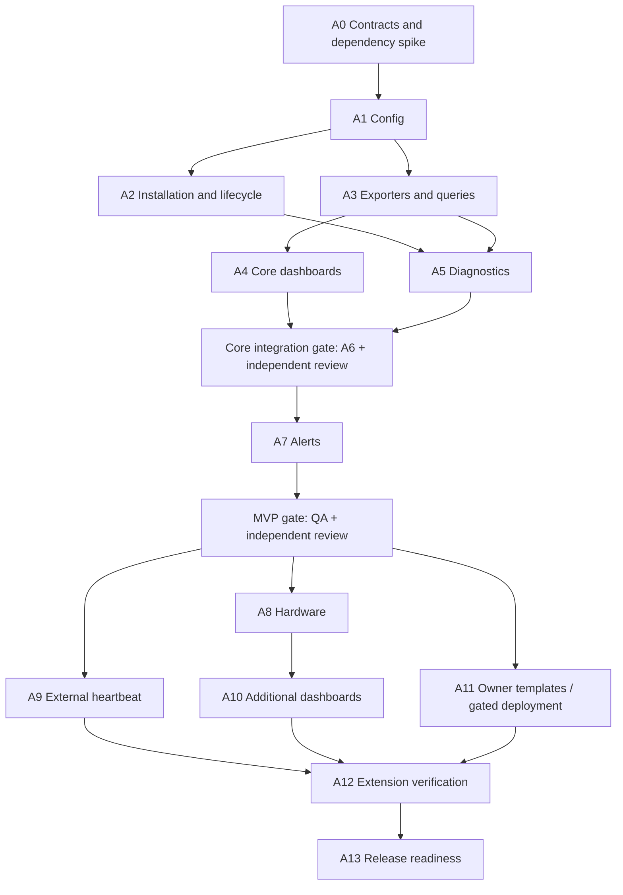

# Implementation plan — Windows PC Monitoring

วันที่: 2026-11-13 | สถานะ: แผนสำหรับมอบหมายงาน ยังไม่ได้ implement หรือยืนยัน runtime

## เป้าหมายและขอบเขต

อ้างอิง `PC_MONITOR_REQUIREMENTS.md` เป็นข้อกำหนดหลัก ใช้ MIT สำหรับงานต้นฉบับของโปรเจกต์ และคง license ของ third-party components แยกกัน ใช้ PowerShell/configuration/provisioning เชื่อม Windows exporters, Prometheus และ Grafana โดยไม่สร้าง frontend/backend ใหม่ ไม่ใช้ Docker หรือ WSL

แบ่ง milestone เพื่อแก้ความกำกวมของคำว่า MVP:

- **Core local complete:** dashboard localhost แสดงข้อมูลระบบ/process จริง ติดตั้งซ้ำได้ และ services เริ่มหลัง reboot โดยไม่ login
- **MVP complete:** Core local + synthetic alert ที่ทดสอบ firing/resolved email จริง พร้อม target-down และ NoData/Error policy
- **Full distribution complete:** เพิ่ม hardware coverage, external offline heartbeat, optional owner deployment และ release gates ตามข้อกำหนด

การใช้ SMTP เป็น optional สำหรับผู้ติดตั้งทั่วไป แต่ห้ามระบุว่า alert delivery verified หากยังไม่มีหลักฐานรับอีเมลจริง ส่วน sensor หรือ owner profile ที่ไม่ได้ทดสอบต้องระบุ unsupported/untested/skipped ตามจริง

## วิธีประสานงาน

Master เป็นผู้เดียวที่แก้ README, เอกสารแผนนี้ และ `.axon/tasks/implementation-plan.md` ระหว่างงานนี้ ก่อนเริ่ม implementation ให้เปิด coordination record ใหม่สำหรับ execution และคงแผนนี้เป็น baseline

ทุก assignment ต้องระบุ task ID, owner, dependencies ที่ผ่านแล้ว, allowed files, acceptance criteria และหลักฐานที่ต้องส่ง ทุก agent ต้องรับทราบว่าใช้ workspace ร่วมกัน ห้ามย้อน edits ของผู้อื่น ห้าม nested delegation และห้ามแก้ไฟล์นอก ownership โดยไม่ส่งคำขอให้ Master จัดสรรใหม่

ไฟล์ที่ส่งมอบแล้วจะเปลี่ยนเจ้าของได้เมื่อ Master ปิด assignment เดิมและบันทึกการโอน ownership เท่านั้น งาน QA/review เริ่มด้วย read-only; ถ้าต้องแก้ production code ให้ส่งกลับเจ้าของเดิมก่อน แล้วจึงทดสอบซ้ำ

สูงสุด 3 subagents พร้อมกัน เพื่อเหลือ 1 slot ให้ Master งานที่ share contract หรือไฟล์เดียวกันต้องรอ dependencies งานอ่านอิสระและงานเขียนคนละไฟล์รันขนานได้

## งานและ ownership

| ID / Owner | ขอบเขตไฟล์ที่เขียนได้ | Dependencies | ผลส่งมอบและเกณฑ์รับงาน |
|---|---|---|---|
| A0 / software_eng | `docs/ARCHITECTURE.md`, `docs/DEPENDENCIES.md`, `docs/contracts/*`, `config/dependencies.lock.json`, `THIRD_PARTY_NOTICES.md` | ไม่มี | ตรวจ official upstream แล้วเลือก tested candidates, Windows artifacts, SHA-256, license, service-host strategy, collector compatibility และ contract ด้านล่าง ต้องมีหลักฐาน service strategy smoke test บน test host ที่อนุญาต ก่อน freeze สัญญา ห้ามเดารุ่นหรือระบุว่าทุก binary เป็น Windows service ได้เอง |
| A1 / backend | `scripts/lib/Config.psm1`, `scripts/lib/Secrets.psm1`, `scripts/validate-config.ps1`, `config/schema.json`, `config/local.example.psd1`, `config/owner.example.psd1` | A0 | config parsing/validation/generation contract; defaults เป็น local; reject invalid profile/ports/intervals/hostname และไฟล์ config ที่ไม่ใช่ data; ไม่ log secrets; ไม่มี side effects เมื่อ validate; implement secret store/provisioning และ service-readable Grafana bootstrap credentials ก่อน A2 โดยขั้น apply ต้องอยู่ใน authorization |
| A2 / backend (คนละ agent กับ A3 เมื่อรันขนาน) | `scripts/lib/Artifacts.psm1`, `scripts/lib/Services.psm1`, `scripts/install.ps1`, `scripts/uninstall.ps1`, `scripts/start.ps1`, `scripts/stop.ps1`, `scripts/backup.ps1`, `scripts/restore.ps1` | A0, A1 | checksum ก่อน execute; plan/WhatIf ก่อน apply; install/rerun/upgrade/uninstall contract รักษา config/secrets/history; service startup/recovery; rollback เมื่อ install ล้มเหลว; backup/restore consistency ตาม contract |
| A3 / backend | `config/prometheus.yml.tpl`, `config/exporters/*`, `config/recording-rules/*`, `docs/METRICS_REFERENCE.md`, `docs/fixtures/metrics/*` | A0, A1 | collector config และ PromQL เทียบ metrics จริงของ pinned releases; CPU normalization/identity/units; filters/cardinality; fixtures ต้อง synthetic หรือ anonymized และไม่มี secrets |
| A4 / frontend | `config/grafana/grafana.ini.tpl`, `config/grafana/provisioning/datasources/*`, `config/grafana/provisioning/dashboards/*`, `config/grafana/dashboards/overview.json`, `config/grafana/dashboards/processes.json` | A1, A3 | provision datasource/dashboard UID คงที่; Overview/Processes แสดงข้อมูลจริง; units, time ranges, filters และ missing-data states ชัดเจน ใช้ Grafana provisioning ไม่สร้าง web app |
| A5 / backend | `scripts/status.ps1`, `scripts/doctor.ps1`, `docs/TROUBLESHOOTING.md` | A1, A2, A3 | status แบบ structured + readable พร้อม exit codes; ตรวจ bind/targets/service/permissions/data age/cardinality/disk; ไม่แสดง secret หรือส่ง inventory ออกนอกเครื่อง |
| A6 / qa_tester | `tests/config/*`, `tests/powershell/*`, `tests/prometheus/*`, `tests/dashboards/*`, `tests/integration/core/*`, `.github/workflows/validate.yml`, `docs/TEST_MATRIX.md` | A0 สำหรับแผนทดสอบ; A1–A5 สำหรับรันครบ | ทำ tests ที่จับ behavior/error boundaries จริง พร้อม CI ตั้งแต่ core phase; ทดสอบ T01–T04/T14/T19/T20 และ install preservation ส่วน core ของ T15; แยก safe CI กับ opt-in host integration |
| A7 / backend | `config/grafana/provisioning/alerting/*`, `config/grafana/email-templates/*`, `scripts/test-alert.ps1`, `docs/SMTP_ALERTS.md` | Core gate ผ่าน; A0 secret contract | SMTP secure config, synthetic test metric path ที่อนุมัติไว้, alert pending/recovery/grouping, warning/critical และ missing telemetry policy; test alert ต้อง cleanup และไม่กระตุ้นความร้อน/โหลดอันตราย |
| A8 / backend | `config/exporters/hardware/*`, `src/smart-adapter/*`, `scripts/hardware/*`, `docs/HARDWARE_COMPATIBILITY.md`, `docs/fixtures/hardware/*` | MVP gate ผ่าน | audit hardware exporter/license/privileges ก่อนใช้; capability baseline และ device-to-volume mapping; ทำ custom SMART adapter เฉพาะเมื่อเครื่องมือที่ดูแลอยู่ไม่เพียงพอ ห้าม fake sensor values |
| A9 / backend | `scripts/heartbeat/*`, `docs/OFFLINE_HEARTBEAT.md` | MVP gate ผ่าน | heartbeat/task lifecycle, HTTPS secret protection, retry/timeout/jitter; ทำงานโดยไม่ login; external DOWN/RECOVERED evidence; maintenance/snooze และระบุว่า bare heartbeat ไม่รับรอง monitoring stack |
| A10 / frontend | `config/grafana/dashboards/cpu-thermal.json`, `config/grafana/dashboards/storage-network.json`, `config/grafana/dashboards/monitoring-health.json` | A8 และ A3 contract | dashboards ครบตาม capability และ missing-data semantics; ไม่แก้ overview/processes โดยพลการ ถ้าต้องเชื่อมให้ Master โอน ownership จาก A4 |
| A11 / software_eng | `docs/CLOUDFLARE_OWNER.md`, `config/cloudflare/*` | MVP gate ผ่าน; FQDN/zone/tunnel ที่ยืนยันแล้วก่อน deploy | ทำ templates/checklist แบบไม่มี credentials; Access ต้องป้องกัน route ก่อนประกาศพร้อมใช้; ตรวจ allowed/denied/anonymous และไม่เปิด exporters/Prometheus การ deploy เป็นขั้นแยกจาก authoring |
| A12 / qa_tester + code_reviewer (แยก assignment) | QA: `tests/integration/extensions/*`, อัปเดต `docs/TEST_MATRIX.md`; reviewer: read-only | ฟีเจอร์ที่ตรวจส่งมอบแล้ว | QA ตรวจ T05–T18/T20 และ regression ที่ได้รับผล; reviewer ตรวจ security/maintainability/diffs โดยไม่แก้ไฟล์ QA ต้องส่ง test artifacts ที่ปกปิดข้อมูล และต้องไม่ตรวจรับงานของตนเองแทน independent reviewer |
| A13 / Master | `README.md`, `.gitignore`, `docs/INSTALL_WINDOWS.md`, `docs/SECURITY.md`, `docs/CONTRIBUTING.md`, `docs/RELEASE_CHECKLIST.md`, coordination records | ตาม milestone; release รอทุก required gate | รวมงาน รักษา MIT/third-party notices, install/upgrade/restore guide, ข้อจำกัด, release checklist และ evidence summary ไม่ commit/publish/deploy โดยอนุมานจากงานวางแผนนี้ |

A8 เป็นเจ้าของเฉพาะ subdirectory hardware; A3 ห้ามแก้ subtree นี้เมื่อ A8 เริ่ม หากมีไฟล์ทับซ้อนให้หยุดและให้ Master โอน ownership ก่อน งานแก้ integration ที่ไฟล์หลาย owner ต้องเรียงลำดับทีละ assignment

## Contracts ที่ A0 ต้อง freeze ก่อน fan-out

1. **Dependency/service contract:** version/platform/download URL/hash/license, collector flags และ metrics fixture; ตรวจ Windows/PowerShell support จริง; ระบุ service wrapper ถ้าจำเป็นพร้อม license/hash; service names, executable arguments, automatic startup, recovery, account และ dependency order
2. **Paths/permissions:** code/binaries แยกจาก mutable data/logs/config/secrets นอก repository; เลือก Program Files/ProgramData paths ที่แน่นอน; ระบุ ACL ของแต่ละ path และบัญชีที่อ่าน/เขียนได้; ผู้ใช้ทั่วไปต้องแก้ service executable/config หรืออ่าน secrets ไม่ได้
3. **Configuration:** ใช้ `.psd1` สำหรับ non-secret local input โดยอ่านเป็น restricted data เท่านั้น และ JSON schema สำหรับ validation ที่กำหนด mapping ชัดเจน; defaults → selected profile → protected local override; secrets โหลดผ่าน interface แยก; ห้ามทำทั้ง .env และ .psd1 parser หากไม่จำเป็น ระบุ encoding, escaping, unknown keys, relative paths และค่าที่ต้อง restart
4. **Secrets:** เลือก storage ที่ service identity ใช้ได้โดยไม่ login; กำหนด `Get-MonitorSecret` interface, provisioning/rotation/redaction และ account recovery ห้ามอาศัย Credential Manager ของ interactive user โดยยังไม่ทดสอบ service access; template มีแค่ชื่อ setting/reference ไม่ใส่ค่าจริง
5. **Script interface:** PowerShell 5.1 baseline จนกว่าจะพิสูจน์ว่าต้องใช้ 7; validation/doctor ไม่เปลี่ยนเครื่อง; mutating scripts รองรับ SupportsShouldProcess/WhatIf และยืนยัน host changes; structured results แยกจาก logs, กำหนด exit codes และไม่มี secrets ใน errors/arguments
6. **Metrics:** stable datasource/job/host labels, metric names/units, host-total CPU denominator, process identity/PID reuse policy, inclusion/exclusion ที่ collection และ cardinality budget; UID/dashboard variables ใช้สัญญาเดียวกัน การแสดง top-N ไม่ทดแทนการคุมจำนวน series ที่เก็บ
7. **Availability:** แยก disabled/unsupported/permission-denied/stale/down/error; baseline ความสามารถต่อเครื่อง; ระบุ sensor ใด required/optional, disappearance timeout, NoData/Error และ recovery hysteresis ต่อ alert; ไม่แจ้ง critical ถาวรเพราะ optional sensor ไม่เคยรองรับ
8. **Data lifecycle:** การสำรอง Grafana DB/provisioning/config และ Prometheus snapshots หรือ controlled-stop strategy; secret backup policy; restore compatibility, upgrade rollback และการลบข้อมูลต้อง opt-in แยกจากถอน service
9. **Acceptance thresholds:** เลือก workload/sample window/tolerance เทียบ Windows counters; วัด baseline ก่อนตั้ง CPU/RAM/series/scrape-duration budget; อธิบาย 30d retention กับ size guard โดยไม่รับประกันเก็บครบ 30 วันเมื่อชนขนาด และไม่อ้างว่า size guard เป็น hard cap ของทุกไฟล์

Decision ที่ยังพิสูจน์ไม่ได้ให้บันทึก pending พร้อม owner/test ที่ต้องทำ ห้ามเริ่ม consumer ของ contract ส่วนนั้น หรือรายงาน A0 ผ่านด้วย placeholder

## Scheduling และ dependency gates



A7 ใช้ secret store ที่ A1 ส่งมอบแล้ว ไม่สร้าง storage ใหม่ หากต้องแก้ Secrets.psm1 ให้ Master โอน ownership จาก A1 ก่อน เช่นเดียวกับ SMTP settings ใน grafana.ini.tpl ซึ่ง A4 เป็นเจ้าของ: A7 ใช้ renderer/secret-reference contract ที่ freeze ไว้ หรือขอโอน ownership เพื่อเพิ่ม template settings แล้วทดสอบ generation ซ้ำก่อนเปิด alert gate ห้ามใส่ SMTP secrets ใน provisioning ที่ commit เข้า Git

Core scheduling: หลัง A1 ให้ A2/A3/A6 ทำงานพร้อมกัน (A6 เริ่ม fixtures/test harness/CI ใน ownership ของตน) เมื่อมี slot จึงเริ่ม A4 แล้ว A5; A6 รันทดสอบรวมเมื่อ dependencies ครบ Review ทำเป็นอีก assignment หลัง implementation ส่งมอบแล้ว

A12 เป็นงาน verification หลายรอบ: reviewer ตรวจ core หลัง A6; QA/reviewer ตรวจ A7 ทันทีเพื่อปลด MVP gate ก่อนเปิด A8/A9/A11 แล้วตรวจ extensions ทีละ feature และรวมรอบ release ไม่รอ extensions ครบก่อนเริ่ม A12 งาน A7 alert tests อยู่ใน tests/integration/extensions/alerting ซึ่ง QA เป็นเจ้าของ ส่วนผู้แก้ production code ยังคงเป็น A7

Extensions: A8/A9/A11 ทำขนานได้เฉพาะส่วนที่ contract คงที่และคนละไฟล์; QA ทำเมื่อ slot ว่างและ feature ส่งมอบแล้ว A11 authoring เริ่มได้แม้ยังไม่มี credentials แต่ remote deployment gate จะยังไม่ผ่าน

## Test gates และหลักฐาน

| Gate | สิ่งที่ต้องพิสูจน์ | Requirement coverage |
|---|---|---|
| Static / CI | PS parsing/lint, config validation positive/negative, JSON/provisioning, Prometheus config และ recording-rule fixtures, secret scan; pin test tooling; ไม่มี production credentials หรือ host changes ใน default CI | T14; ส่วน static ของ T19/T20 |
| Core local | fresh Windows test host, real metrics/process CPU+RAM, loopback bind/auth, query compatibility กับ pinned exporters, all 3 services หลัง reboot โดยไม่ login; install rerun ไม่ reset ข้อมูล; invalid hash/port conflict/partial failure ต้อง fail ปลอดภัย | T01–T04, T14, core T15, T19, T20 |
| MVP alerts | synthetic firing และ resolved email, grouping/repeats, exporter stopped/recovery, required-data loss/error และ SMTP unavailable; ทดสอบ cleanup, timeout และป้องกัน log secret | T07–T09, T17 |
| Hardware | sensor capability/absence, actual values/units เทียบ diagnostic tool, physical disk mapping, permission denied; ไม่อ้างรองรับ hardware ที่ไม่ทดสอบ | T05–T06; extended T03/T19 |
| Offline | suspend heartbeat / stop local services ตาม test scenario, hosted DOWN และ RECOVERED email, maintenance handling, task หลัง reboot/no login | T10–T11 |
| Owner | FQDN/zone ยืนยัน, HTTPS, Access allowed/denied/anonymous, Grafana auth, ไม่มี exporter/Prometheus route และตรวจ IPv4/IPv6 binding; generic local clone ไม่ต้องใช้ owner values | T12–T13, T18, T20 |
| Operations / release | backup→restore บน installation แยก, upgrade/rollback และ preservation, retention/size-pressure behavior, overhead baseline, license/notices และ secret scan รอบสุดท้าย | T14–T16; regression ทุก required feature |

ทุก test record ต้องระบุ commit หรือ working-tree diff, OS/build, component versions, commands/exit codes, UTC หรือ timestamp พร้อม timezone, expected/actual และผล PASS/FAIL/SKIPPED/BLOCKED แยก automated กับ manual evidence

SMTP ต้องมีหลักฐานผู้รับยืนยันหรือ mailbox evidence ที่ได้รับอนุญาตพร้อม correlation ID ของ alert ไม่ใช้ HTTP success หรือ SMTP accepted เพียงอย่างเดียวแทน delivery; ห้ามใส่ข้อความส่วนตัว/credentials ลง artifact

Reboot gate ต้องมี boot/service timestamps และผลตรวจหลัง boot ก่อน interactive login โดยวิธีเก็บหลักฐานที่อนุญาตไว้ Hardware ต้องมี model/driver/privilege ใน local evidence ที่ปกปิดก่อนแชร์ Cloudflare ต้องตรวจจากภายนอกจริง ไม่ใช้ localhost response แทน unauthorized remote test

สิ่งที่ยังไม่มีเครื่อง/บัญชี/permission ให้ระบุ BLOCKED หรือ SKIPPED พร้อมเหตุผลและขั้นตอนทดสอบ ห้ามนับเป็นผ่าน สามารถปิดงาน authoring ได้เมื่อ deliverable ครบ แต่ milestone runtime ยังไม่ complete

## ขอบเขตการเปลี่ยนเครื่องและ external systems

งาน implementation ปกติทำได้ถึง code/config/docs, unit/static tests และ review ภายใน workspace การทดสอบที่ติดตั้งหรือหยุด services, reboot, firewall/ACL/system changes, เปลี่ยน cloud DNS/Access/tunnel, สมัครหรือแก้ hosted check และส่ง email ต้องตรวจ authorization ที่มีอยู่ก่อนทำ

ข้อกำหนดโปรเจกต์บรรทัด 13 ระบุว่า "Require confirmation for actions that alter the host." จึงต้องเตรียม diff, dry-run/WhatIf, affected services/paths, expected effects, rollback และ test sequence ให้ตรวจได้ก่อนขออนุมัติขั้น apply หาก session อนุมัติขอบเขตนั้นแล้วให้ดำเนินการตามขอบเขตเดิม ไม่ถามซ้ำ งานวางแผนนี้ยังไม่ใช่ authorization ให้เปลี่ยนเครื่องหรือ cloud

Secret/provider ที่ยังไม่มีไม่ขวางการเขียน templates และ safe tests แต่ขวาง runtime gates ที่เกี่ยวข้อง ห้ามส่งข้อความหรือติดต่อบุคคลอื่นเพื่อขอ credentials เอง

## Assignment / handoff template

Master ส่ง packet ต่อไปนี้ให้ agent ทุกครั้ง โดยกรอกให้เฉพาะเจาะจง:

```text
Task ID / role:
Objective / acceptance criteria:
Allowed files (exclusive edit ownership หรือ read-only):
Dependencies / accepted contracts / relevant evidence:
Constraints: shared workspace; preserve unrelated edits; no nested delegation;
            no host/external changes outside existing authorization; redact secrets.
Required tests / expected artifacts:
Return standard handoff; flag any ownership conflict or stale contract before editing.
```

```markdown
## <Agent> Handoff
**Status**: Completed | Blocked — reason
**Scope / Deliverables**: changed files, decisions, contract version
**Evidence**: commands + exit codes, diffs, tests, redacted artifacts
**Verification**: PASS | FAIL | N/A — reason for each applicable gate
**Risks / Deferred**: untested hardware, external dependencies, skipped gates
**Recommended Next Step**: owner and concrete action
```

Master ตรวจ diff และหลักฐานจริงก่อนรับ handoff หาก fail ให้ส่งกลับพร้อม gate ที่ไม่ผ่าน หลังแก้ไม่สำเร็จ 2 รอบสำหรับ gate เดิม ให้หยุด fan-out และรายงาน blocker/evidence ไม่เลื่อนเป็นผ่าน

## ขั้นเริ่ม execution

1. Master เปิด execution record และมอบ A0 ให้ software_eng พร้อมข้อกำหนดนี้
2. A0 ทำ read-only official-source research และเตรียม dependency/service spike ที่ตรวจได้ ก่อนทดสอบ host changes ตาม authorization
3. Freeze contracts ที่มีหลักฐานแล้ว จึงมอบ A1; ส่วนที่ยัง pending ให้ระบุ blocker แทนการเดา
4. Master ทำ `.gitignore` ก่อนสร้าง generated config, artifacts, logs หรือ local overrides และตรวจ repository status ก่อนทุก handoff
5. เดิน dependency graph จนถึงแต่ละ milestone; แยก authoring complete, runtime verified และ release ready ให้ชัดเจน
